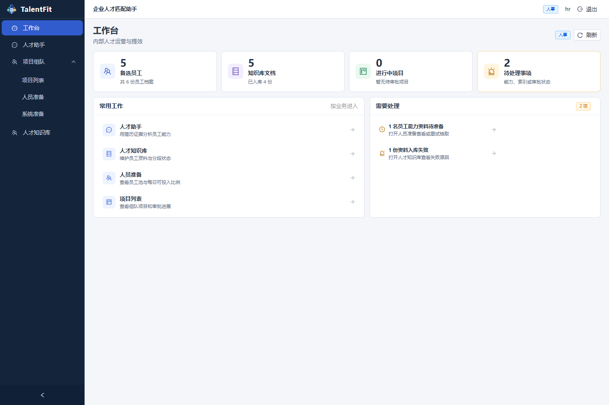
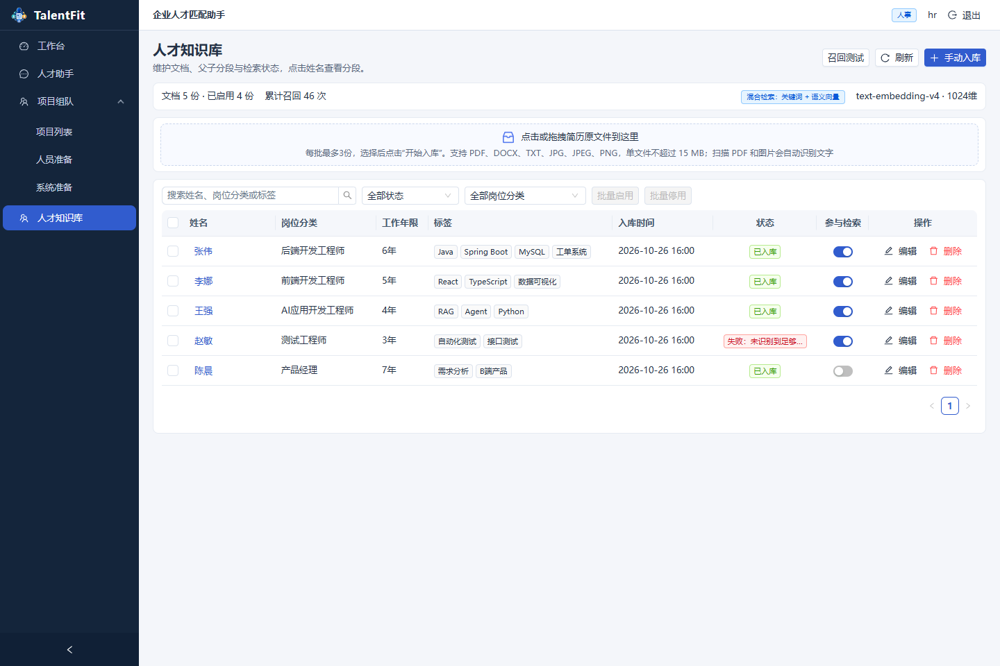
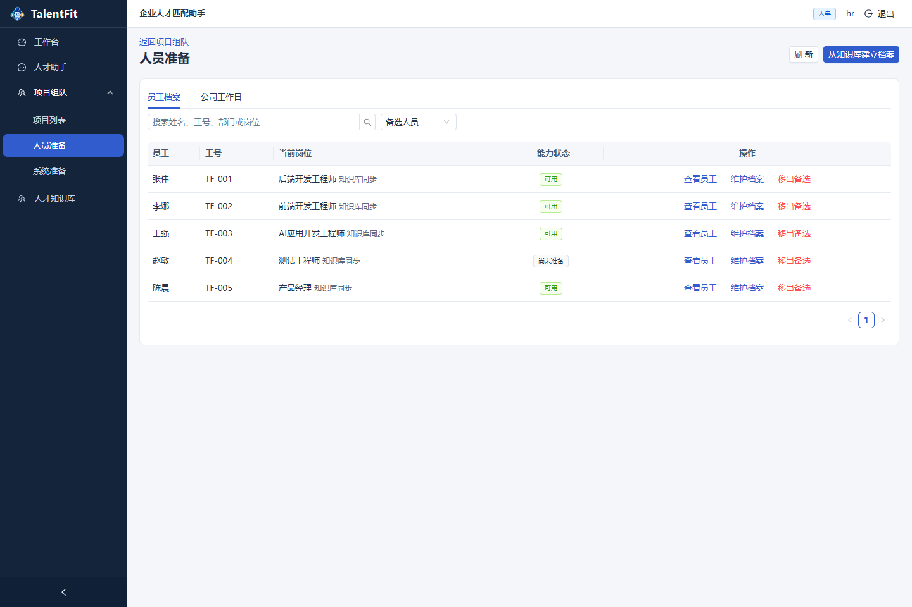
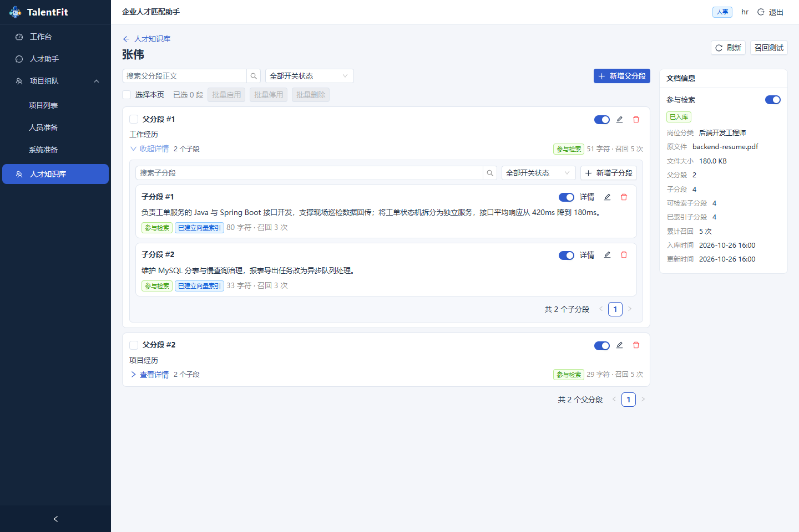
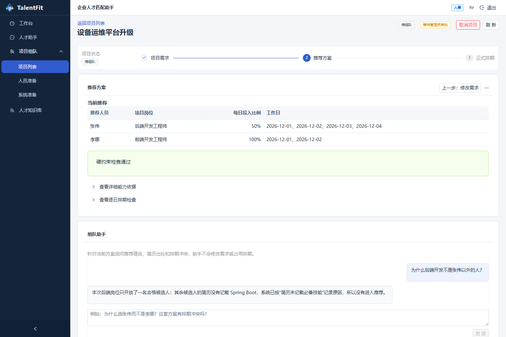
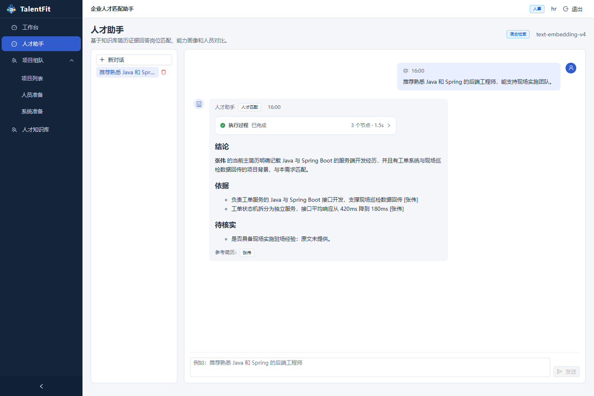
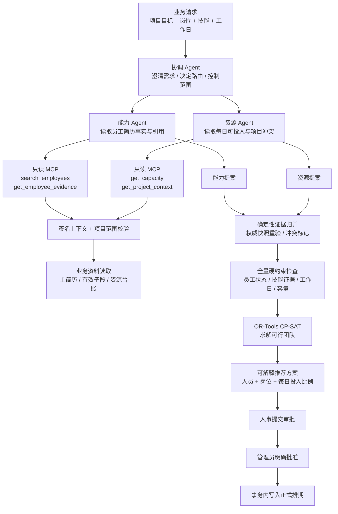
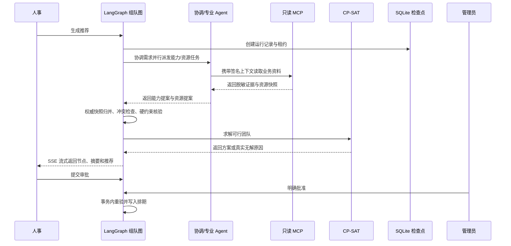
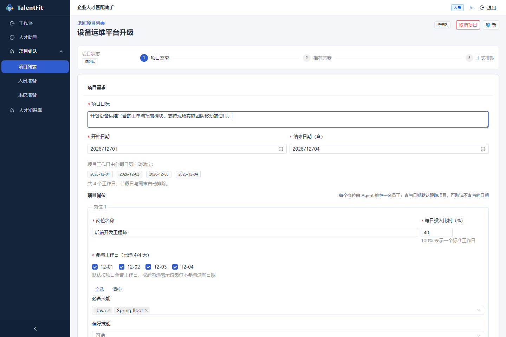
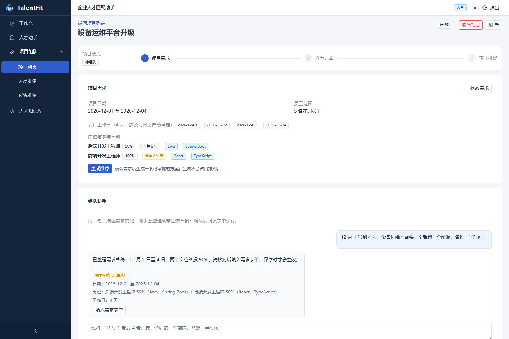

# TalentFit Agent

> 面向企业内部的人才知识与项目协作平台：让简历证据沉淀为可检索的知识，让员工能力与可投入时间服务于真实项目。

TalentFit Agent 将企业人才知识库、人才助手和项目组队整合为一个前后端分离应用。它不做公开招聘流程，而是服务于已经入职员工的资料维护、能力分析、项目组队和资源排期。

<p align="center">
  <strong>证据驱动</strong> · <strong>Multi-Agent 协作</strong> · <strong>混合检索</strong> · <strong>确定性排期</strong>
</p>



> **TalentFit 的核心不是“让模型猜一个人”，而是把员工证据、工作日和项目约束接成一条可追溯的执行链。**

## 你可以用它做什么

- **维护人才知识库**：上传 PDF、DOCX、TXT 或图片简历，按父子分段建立关键词与向量索引。
- **基于证据对话**：人才助手只引用当前有效简历分段，支持人才匹配、个人画像、多人对比和普通问答。
- **管理员工资源**：将知识库资料关联到员工身份，维护岗位类别、部门、备选状态和每日可投入比例。
- **项目组队**：填写项目目标、岗位、技能和工作日，Agent 结合简历事实与排期生成可解释的推荐方案。
- **对话整理需求**：人事用一句话描述需求变化，模型给出未确认草稿，确认保存后才成为新的需求版本；管理员可在同一入口追问推荐理由。
- **审批后占用排期**：人事提交推荐，管理员明确批准后才写入正式员工排期。
- **动态执行记录**：聊天和组队运行按真实节点流式展示，支持后台 worker、检查点、受限 MCP 工具和 CP-SAT 约束求解。

## 界面一览

### 工作台与知识库

| 内部人才运营 | 人才知识库 |
| --- | --- |
|  |  |

### 人员资源与分段

| 人员准备 | 父子分段管理 |
| --- | --- |
|  |  |

### 组队与 Agent

| 项目推荐 | 人才助手 |
| --- | --- |
|  |  |

> 页面截图使用姓名、岗位和项目均为示例内容，不包含本机简历、联系方式或员工台账。

## 技术架构

TalentFit 把“理解需求”和“执行决策”拆开：模型负责理解、查询和解释；证据归属、硬约束、排期冲突与最终写入由确定性服务负责。

### Multi-Agent 组队架构



### 每个 Agent 的职责边界

| 角色 | 负责什么 | 明确不能做什么 |
| --- | --- | --- |
| **协调 Agent** | 理解需求、判断是否需要能力/资源查询、汇总运行摘要 | 不批准、不写排期、不替换员工 |
| **能力 Agent** | 从当前有效主简历子段读取技能、经历和引用 | 不从全文标签推断能力，不把他人/团队技术算到员工名下 |
| **资源 Agent** | 读取工作日、可投入比例、已有占用和冲突 | 不把未知时间当空闲，不修改台账 |
| **证据归并层** | 归并专业提案，和权威快照重新核验，标记分歧 | 不用模型投票覆盖事实 |
| **CP-SAT 求解器** | 根据全量候选池和硬约束求解可行方案 | 不生成简历事实，不直接写数据库 |
| **审批事务** | 最终重验版本、证据和每日容量并落地排期 | 未经管理员批准不产生正式占用 |

### 一次推荐如何运行



这套设计让 Multi-Agent 有清晰的“观察—提案—核验—求解—审批”边界：Agent 可以并行探索，但任何不确定的事实都会停在等待补充或重新核验，不会被包装成确定结论。

## ✨ 三个值得展示的设计点

| 01 · Evidence First | 02 · Agent Mesh | 03 · Safe Execution |
| --- | --- | --- |
| 技能、经历和岗位结论都必须回到当前有效简历子段，保留可核验引用。 | 协调、能力、资源三个角色按需路由，专业任务可以并行，运行过程实时可见。 | MCP 只读、求解器确定、审批写入；模型不会越权修改员工资料或排期。 |

> **从一句项目需求，到一份可审批的团队方案，中间每一步都留下业务可读的轨迹。**

### 技术选型

| 层次 | 技术 | 用途 |
| --- | --- | --- |
| 前端 | React 18、TypeScript、Vite、Ant Design | 中文业务界面、流式状态、表格和操作工作台 |
| API | Python 3.11、FastAPI、SQLAlchemy | 认证、权限、知识库、聊天和项目业务接口 |
| Agent | LangGraph、OpenAI 兼容接口 | 对话图、需求协调、能力与资源专业子图 |
| 检索 | SQLite FTS5、jieba、BM25、Qwen `text-embedding-v4`、RRF | 关键词与语义向量混合检索 |
| 文档解析 | pypdf、python-docx、PDFium、RapidOCR | 简历正文提取、版面顺序恢复和 OCR 回退 |
| 组队求解 | OR-Tools CP-SAT | 技能、工作日、每日投入比例和排期约束求解 |
| 工具与运行 | 官方 MCP SDK stdio、独立 Worker、SQLite Checkpoint | 受限只读工具、后台运行、断点与事件重放 |

## 快速运行

### 环境要求

- Windows 10/11
- Python 3.11+
- Node.js 18+
- PowerShell
- 可访问的 OpenAI 兼容模型接口；没有模型配置时，页面和基础管理功能可以启动，但 Agent 对话和模型抽取不可用

### 1. 安装依赖

在项目根目录执行：

```powershell
.\scripts\setup.ps1
```

脚本会创建根目录 `chAgent` Python 虚拟环境、安装后端锁定依赖、创建 `backend/.env` 并安装前端依赖。 `backend/.env` 不会被 Git 跟踪。

### 2. 配置模型

编辑 `backend/.env`：

```dotenv
OPENAI_API_KEY=你的模型密钥
OPENAI_BASE_URL=https://你的兼容接口/v1
MODEL_NAME=qwen3.6-35b-a3b
EMBEDDING_ENABLED=true
EMBEDDING_MODEL=text-embedding-v4
EMBEDDING_DIMENSIONS=1024
```

如果供应商要求对话模型和嵌入模型使用不同密钥或地址，可填写 `EMBEDDING_API_KEY` 和 `EMBEDDING_BASE_URL`。不要把真实密钥提交到 GitHub。

### 3. 启动服务

```powershell
.\scripts\dev.ps1
```

访问：

- 前端：<http://127.0.0.1:5173>
- API 文档：<http://127.0.0.1:8000/docs>

停止服务：

```powershell
.\scripts\stop.ps1
```

启动脚本会同时管理 FastAPI、前端 Vite、项目组队 Worker 和本地 stdio MCP 子进程。运行日志位于 `data/runtime/`，该目录不会进入发布包。

## 本地演示账号

发布模板中的账号用于本地演示，首次部署到真实环境后请立即修改：

| 角色 | 用户名 | 密码 | 权限 |
| --- | --- | --- | --- |
| 老板 / 管理员 | `admin` | `TalentFit-Admin-2026!` | 查看资料、使用 Agent、批准项目组队 |
| 人事 | `hr` | `TalentFit-HR-2026!` | 管理知识库、员工档案、工作日、需求和推荐提交 |

账号由 `backend/.env` 中的 `ADMIN_*` 与 `HR_*` 变量初始化。正式部署请替换密码和 JWT 密钥。

## 简单使用教程

### A. 建立人才知识库

1. 使用人事账号登录，进入 **人才知识库**。
2. 点击上传区域，选择最多 3 份 PDF、DOCX、TXT、JPG 或 PNG 文件。
3. 点击“开始入库”，观察提取、审核、整理、分段、关键词索引和向量索引进度。
4. 在列表中检查姓名、岗位分类、标签和入库时间。
5. 点击姓名进入文档详情，展开父分段查看对应子分段；可启停、编辑或删除最终分段。


### B. 建立员工资源档案

1. 进入 **项目组队 → 人员准备**。
2. 点击“从知识库建立档案”，把已入库资料关联到员工身份。
3. 检查当前岗位、能力状态和备选状态。
4. 公司工作日默认按周一至周五计算；工作日没有个人覆盖时，员工默认可投入 100%。
5. 遇到请假、调休或特殊限制时，只调整对应日期的个人可投入比例。


### C. 发起一次项目组队

1. 进入 **项目组队 → 项目列表**，点击“新建组队项目”。
2. 填写项目名称、目标，以及开始日期和结束日期（起止两天都包含）。
3. 区间内的公司工作日会自动列成标签，周末和节假日自动排除，不需要逐日勾选。
4. 在“项目需求”卡片里填写岗位、每日投入比例和必备技能。每个岗位默认参与项目全部工作日，可以取消不参与的日期（例如采购只在第一周介入）；也可以先把一句话需求交给组队助手整理成草稿。
5. 保存需求后，卡片里会显示需求摘要；点击“生成推荐”，页面进入“推荐方案”阶段，可以看到节点进度、推荐人员、技能依据和排期检查。推荐阶段可以点“上一步：修改需求”退回。
6. 人事点击“提交审批”；管理员核对推荐后点击“批准并占用排期”，页面进入“正式排期”阶段。
7. 已生效项目可以提前结束或取消，系统会释放当前及未来的员工占用并保留历史记录。

保存时如果字段不合法，页面会指出具体位置，例如“岗位 1 · 每日投入比例：不能大于 100”，而不是只提示“需求不合法”。




### D. 用对话整理需求

组队助手只在对应阶段出现：需求阶段提供“改需求”，推荐/排期阶段提供“问方案”。

- **改需求**：人事用一句话描述变化（例如“12 月 1 号到 4 号，要一个后端一个前端，各投一半时间”），模型把这句话整理成未生效的需求草稿；核对后点击“填入需求表单”，在表单里保存才会产生新的需求版本。
- **问方案**：询问推荐理由、简历出处或排期冲突；也可以直接问“为什么不是某某”。助手只用当前方案的成员、简历事实和“未入选候选及原因”回答，不会修改需求或占用排期。



已确认需求可以在“项目需求”卡片里直接点“修改需求”重新编辑；保存后旧方案自动变成历史版本，需要重新生成推荐。

### E. 使用人才助手

1. 进入 **人才助手**，点击“新对话”。
2. 可以询问员工能力、简历依据、多人差异或项目匹配问题。
3. 助手会流式展示实际执行节点和回答内容，并标明引用的知识库资料。
4. 结论只使用当前有效主简历的有效子分段；未记载不会被解释为员工不会。


## 代码结构

前后端按业务模块切分，接口层只做参数、权限和响应，业务规则集中在 service，基础设施与业务逻辑不混在一起。

```text
backend/app/
├── main.py              FastAPI 装配：CORS、生命周期、路由挂载
├── api/                 接口与权限边界，一个业务域一个路由模块
│   ├── auth.py          登录与会话身份
│   ├── candidates.py    人才资料与批量入库
│   ├── knowledge.py     文档、父子分段、启停与批量操作
│   ├── knowledge_retrieval.py  召回测试
│   ├── chat.py          个人会话、流式回答、历史删除
│   ├── employees.py     员工身份、主简历关联、工作日与可投入比例
│   ├── staffing.py      项目需求、方案、审批与占用动作
│   └── staffing_runs.py 组队运行、事件流、取消与恢复
├── services/            业务逻辑
│   ├── resume.py        入库流程编排、分词、证据组装
│   ├── extraction.py    文本提取（PDF/DOCX/图片 OCR）
│   ├── preprocessing.py 语义整理与规范化
│   ├── knowledge.py     分段增删改与索引写入
│   ├── retrieval.py     混合检索、RRF 融合、命中统计
│   ├── embeddings.py    向量索引与相似度
│   ├── agent.py         对话图（规划 → 检索 → 生成）
│   ├── llm.py           模型调用与不可用语义
│   └── staffing/        组队业务：图、提案、归并、求解、运行
├── core/                配置、日志脱敏、岗位类别与技能别名
├── db/                  引擎、建表与一次性迁移
├── models/              SQLAlchemy 实体（知识库 / 组队）
├── schemas/             Pydantic 契约，按业务域拆分
├── mcp/                 只读 stdio 工具服务
└── workers/             组队后台 worker（租约、心跳、检查点）

frontend/src/
├── pages/               业务页面（工作台、知识库、组队、助手）
├── components/          复用组件（执行记录、入库队列、组队编辑器、组队助手）
├── services/            API 客户端、SSE 解析、日期与岗位选项
├── styles/              语义变量与页面样式
└── types/               接口类型
```

约定：

- 只有 `api/` 依赖 FastAPI 与权限；`services/` 不关心 HTTP，可直接被 worker、MCP 和测试调用。
- 读取类接口直接返回只读模型；写入类动作统一走 `resource_write` 事务，先锁资源状态行再重验。
- 前端不拼装版本号、指纹和幂等键；接口调用与幂等请求头集中在 `services/staffing.ts`，后端 facade 负责版本、指纹与权限校验。

## 开发验证

```powershell
# 后端：320 个隔离测试（内存数据库 + 合成数据）
cd backend
..\chAgent\Scripts\python.exe -m pytest -q

# 前端：类型检查 + 生产构建
cd ..\frontend
npm run build

# 浏览器验收：本机 Edge、独立端口与临时数据库
npm run test:e2e
```

说明：

- 组队相关用例会启动本地 `chAgent` 的 stdio MCP 子进程，请先执行 `scripts/setup.ps1`。
- Playwright 使用 Edge、独立的 8001/5174 端口和临时测试数据库，不会读写正式人才库；未安装 Edge 时可把 `playwright.config.ts` 的 `channel` 改为已安装的 Playwright 浏览器。
- 冒烟与评估脚本不在发布包内，真实模型验证请在本机使用合成人才和独立数据库。

## 发布包内容

发布包**包含**：源码、依赖清单与锁文件、测试、种子/启动/停止脚本、需求与技术设计文档、示意截图。

发布包**不包含**：本地 SQLite 数据库、简历原文件、员工资料、上传文件、备份、运行日志、Playwright 临时产物、构建产物、虚拟环境和真实模型密钥。`docs/images/` 只保留用于产品展示的示例界面截图。

## 已知边界

当前定位为**单公司本地 MVP**，以下能力明确留在后续迭代：

- 生产部署所需的 HTTPS/网关、密钥托管、数据库服务化、备份策略与多租户隔离。
- 持久异步入库队列与对象存储；当前入库在请求内顺序执行，页面切走不续传。
- 更细的个人可投入比例审批流；当前以人事维护台账 + 管理员批准方案为准。
- 大规模语料下的语义召回优化；当前混合检索使用本地精确余弦扫描，未做性能基准。

## 许可证与使用范围

本项目用于技术展示、内部验证和二次开发。发布前请根据组织要求补充许可证、第三方依赖声明和模型服务条款。
